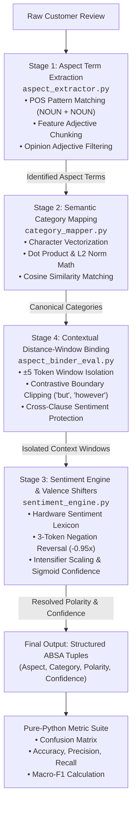

# Aspect-Based Sentiment Analysis (ABSA) for Consumer Reviews
**A 4-Stage Modular NLP Pipeline Implemented from Scratch**

---

## 1. Project Overview & Motivation

Standard sentence-level sentiment analysis assigns a single global label (`Positive`, `Negative`, or `Neutral`) to an entire review. In real-world customer feedback, this is inadequate because consumers frequently express mixed sentiments within a single review:

> *"The OLED screen is gorgeous and crisp, but the battery life is completely terrible."*

A single sentence-level label collapses this nuanced review into either ambiguous Neutral or false Positive/Negative.

**Aspect-Based Sentiment Analysis (ABSA)** resolves this challenge by breaking the review down into granular product aspects, mapping variant terms to canonical product categories, and determining sentiment polarity specific to each aspect.

This project implements a modular 4-stage ABSA pipeline in Python. Each stage features a transparent, from-scratch implementation without relying on opaque deep-learning models or pre-trained transformers.

---

## 2. Pipeline Architecture & System Flow



---

## 3. Modular Implementation Breakdown

### Stage 1: Aspect Term Extraction (`aspect_extractor.py` - 59 lines)
- **NLP Task:** Aspect Term Extraction (ATE)
- **Built from Scratch:** Syntactic pattern chunker and compound noun extractor.
- **How It Works:**
  - Tokenizes and extracts Part-of-Speech tags via lightweight spaCy dependency parses.
  - Scans for compound noun patterns (`NOUN + NOUN` / `compound`, e.g., `"battery life"`, `"customer service"`).
  - Handles feature-noun patterns (`ADJ + NOUN`, e.g., `"touch screen"`, `"sound quality"`).
  - Filters out subjective opinion adjectives using an `OPINION_WORDS` filter (`"great"`, `"awful"`, `"poor"`) so sentiment words are preserved for downstream scoring rather than merged into aspect entities.
- **Viva Questions & Answers:**
  - *Q: Why not just extract all nouns as aspects?*
    - *A:* Single nouns frequently miss compound terminology (`"battery life"`, `"touch screen"`). Moreover, standalone nouns can introduce non-aspect entities (e.g., `"yesterday"`, `"box"`).
  - *Q: How do you prevent sentiment words like "terrible battery" from becoming the aspect?*
    - *A:* We apply an opinion adjective barrier that checks against sentiment lexicons before chunking, ensuring `"terrible"` is reserved for Stage 3's engine.

---

### Stage 2: Semantic Category Mapping (`category_mapper.py` - 58 lines)
- **NLP Task:** Aspect Category Detection (ACD)
- **Built from Scratch:** Vector space construction, dot product, L2 Euclidean norm, and Cosine Similarity.
- **Mathematical Equations:**
  - **Dot Product:**
    $$\mathbf{u} \cdot \mathbf{v} = \sum_{i=1}^{n} u_i v_i$$
  - **Euclidean Magnitude (L2 Norm):**
    $$\|\mathbf{u}\|_2 = \sqrt{\mathbf{u} \cdot \mathbf{u}} = \sqrt{\sum_{i=1}^{n} u_i^2}$$
  - **Cosine Similarity:**
    $$\cos(\theta) = \frac{\mathbf{u} \cdot \mathbf{v}}{\|\mathbf{u}\|_2 \|\mathbf{v}\|_2}$$
- **How It Works:**
  - Deconstructs aspect candidates and category anchor prototypes into character frequency vectors.
  - Computes exact cosine similarity across 8 canonical categories: `CAMERA`, `BATTERY`, `SCREEN`, `PERFORMANCE`, `BUILD_DESIGN`, `AUDIO_CALL`, `PRICE_VALUE`, and `SERVICE_DELIVERY`.
  - Maps to the highest-scoring category exceeding a confidence threshold; otherwise assigns `GENERAL`.
- **Viva Questions & Answers:**
  - *Q: Why use character n-grams/frequencies instead of full word matches?*
    - *A:* Sub-word character vectors handle typographical variations, compounding, and morphology without needing gigabyte-sized word embeddings.
  - *Q: What does a cosine similarity of 1.0 or 0.0 mean geometrically?*
    - *A:* A cosine similarity of 1.0 means the frequency vectors point in identical directions (high overlap); 0.0 means the vectors are orthogonal (no shared features).

---

### Stage 3: Sentiment Engine & Valence Shifters (`sentiment_engine.py` - 56 lines)
- **NLP Task:** Aspect Polarity Classification (APC)
- **Built from Scratch:** Polarity score accumulator, negation reversal lookback window, intensifier multiplication, and sigmoid confidence scaling.
- **Mathematical Equations:**
  - **Valence Inversion:** If a negation token (`"not"`, `"never"`, `"n't"`, `"rarely"`) appears within a 3-token lookback window:
    $$s_{\text{effective}} = -0.95 \times s_{\text{base}}$$
  - **Intensifier / Diminisher Scaling:**
    $$s_{\text{effective}} = w_{\text{modifier}} \times s_{\text{base}} \quad (w_{\text{intensifier}} = 1.5, \; w_{\text{diminisher}} = 0.7)$$
  - **Sigmoid Confidence Normalization:**
    $$\text{Confidence}(S) = 0.65 + 0.65 \times \left(\frac{1}{1 + e^{-|S|}} - 0.50\right)$$
- **How It Works:**
  - Evaluates the tokens in an aspect's contextual window against positive/negative lexicons.
  - Checks prior tokens for valence shifters (e.g., `"does not work"` becomes negative; `"very good"` is boosted by 1.5x).
  - Categorizes net score into `Positive` ($S > 0.20$), `Negative` ($S < -0.20$), or `Neutral`.
- **Viva Questions & Answers:**
  - *Q: What is a valence shifter in linguistics?*
    - *A:* A word that alters the polarity or intensity of an adjacent sentiment word, such as negations (`"not"`, `"rarely"`) or intensifiers (`"extremely"`, `"barely"`).
  - *Q: Why use a sigmoid function for confidence?*
    - *A:* Unbounded modifier scores accumulate with multiple keywords. The sigmoid smoothly compresses unbounded scores into a probability-like confidence metric.

---

### Stage 4: Contextual Distance-Window Binding & Evaluation (`aspect_binder_eval.py` - 83 lines)
- **NLP Task:** Target-Oriented Context Binding & Metrics Calculation
- **Built from Scratch:** Contextual distance-window binding with contrastive boundary detection, and a pure-Python metric calculation suite.
- **How It Works:**
  - **Distance-Window Binding:** Projects a localized token radius ($\pm 5$ tokens) around each extracted aspect span.
  - **Contrastive Boundary Clipping:** Automatically halts context expansion when contrastive conjunctions (`"but"`, `"however"`, `"although"`, `"yet"`, or punctuation `;`, `.`) are encountered. This prevents positive sentiment in one clause from bleeding into a negative aspect in another clause.
  - **Evaluation Suite:** Implements Accuracy, Precision, Recall, Macro-F1, and Multi-Class Confusion Matrix from first principles without scikit-learn.
- **Viva Questions & Answers:**
  - *Q: How does contrastive boundary clipping solve sentiment spillover?*
    - *A:* In *"Great camera, but terrible battery"*, the conjunction *"but"* acts as an explicit boundary. The context for *"camera"* is cut before *"but"*, and the context for *"battery"* starts after *"but"*.
  - *Q: Why use Macro-F1 over Accuracy for sentiment evaluation?*
    - *A:* Real-world datasets suffer from class imbalance (reviews often lean positive). Accuracy can be deceptively high by predicting only the majority class, whereas Macro-F1 weighs all classes equally.

---

## 4. Installation & Quickstart

### Prerequisites
- Python 3.10+
- Virtual environment at `.venv`

### Step 1: Install Dependencies
```powershell
pip install -r requirements.txt
python -m spacy download en_core_web_sm
```

### Step 2: Prepare the Dataset
```powershell
python prepare_data.py
```
This generates:
- `data/sample_reviews.csv` (Sampled Amazon cell phone reviews for batch exploration)

### Step 3: Run Component Modules Individually
Each module is self-contained and can be executed independently:
```powershell
python aspect_extractor.py
python category_mapper.py
python sentiment_engine.py
python aspect_binder_eval.py
```

### Step 4: Run the Complete Pipeline
```powershell
python pipeline.py
```

### Step 5: Launch the Streamlit Web Application
```powershell
streamlit run app.py
```
Or double-click `run_app.bat`.

---

## 5. Streamlined File Structure

```
nlp_lab_project/
├── aspect_extractor.py       # Stage 1: Syntactic chunker & compound noun ATE (59 lines)
├── category_mapper.py        # Stage 2: Vector space dot product & cosine ACD (58 lines)
├── sentiment_engine.py       # Stage 3: Lexicon, negation & intensifier APC (56 lines)
├── aspect_binder_eval.py     # Stage 4: Distance window binding & scratch evaluation (83 lines)
├── pipeline.py               # Unified 4-stage pipeline orchestrator (38 lines)
├── app.py                    # Streamlit interactive web dashboard (143 lines)
├── prepare_data.py           # Dataset sampling (31 lines)
├── requirements.txt          # Minimal project dependencies
├── run_app.bat               # Windows one-click application launcher
├── .gitignore                # Clean repository ignore file
├── data/
│   └── sample_reviews.csv    # 500 sampled reviews
└── README.md                 # Complete project documentation & viva guide
```
